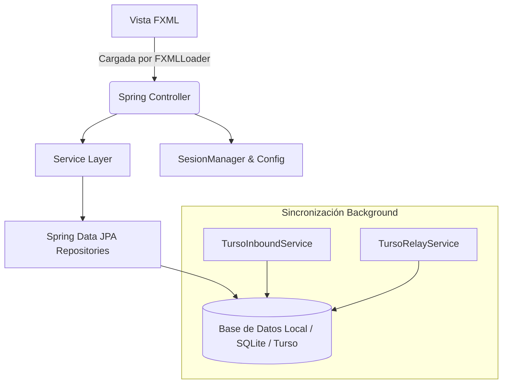

<div align="center">

# 📚 Sistema de Gestión de Biblioteca
### E.P.E.T. N° 36 - Posadas, Misiones

<p align="center">
  
  
  
  
  
  
  
</p>

</div>

---

## 📋 Índice
1. [Descripción y Objetivos del Proyecto](#-descripción-y-objetivos-del-proyecto)
2. [Características y Funcionalidades](#-características-y-funcionalidades)
3. [Tecnologías y Dependencias](#-tecnologías-y-dependencias)
4. [Arquitectura y Patrones Utilizados](#-arquitectura-y-patrones-utilizados)
5. [Estructura de Carpetas](#-estructura-de-carpetas)
6. [Requisitos Previos](#-requisitos-previos)
7. [Instalación y Configuración Paso a Paso](#-instalación-y-configuración-paso-a-paso)
8. [Variables de Entorno y Configuración](#-variables-de-entorno-y-configuración)
9. [Configuración y Modelo de Base de Datos](#-configuración-y-modelo-de-base-datos)
10. [Explicación de Módulos y Reglas de Negocio](#-explicación-de-módulos-y-reglas-de-negocio)
11. [Autenticación y Seguridad](#-autenticación-y-seguridad)
12. [Ejecución y Despliegue](#-ejecución-y-despliegue)
13. [Pruebas](#-pruebas)
14. [Solución de Problemas](#-solución-de-problemas)
15. [Roadmap](#-roadmap)
16. [Autor y Licencia](#-autor-y-licencia)

---

## 🎯 1. Descripción y Objetivos del Proyecto

El **Sistema de Gestión de Biblioteca de la E.P.E.T. N° 36** es una aplicación de escritorio híbrida de alta robustez desarrollada en **Java** y **JavaFX**, integrada con un backend robusto basado en **Spring Boot** y **Hibernate/JPA**. 

**Objetivos principales:**
* Automatizar y optimizar el control del inventario bibliográfico, el registro de préstamos a docentes/responsables y el seguimiento de devoluciones.
* Proveer una interfaz gráfica (UI) altamente responsiva, moderna y accesible, con soporte para ajuste dinámico de tipografía en tiempo real y componentes visuales elásticos adaptados a distintas resoluciones.
* Garantizar la integridad de los datos mediante sincronización local/en nube (soporte con motor SQLite/Turso y patrón Outbox).

---

## 🚀 2. Características y Funcionalidades

* 📦 **Gestión de Inventario de Libros**: Alta, baja, modificación y control de stock físico (disponibles vs. totales). Identificación automática de registros incompletos.
* 🔍 **Control de Préstamos y Autocompletado**: Registro de préstamos asociados a profesores, validación de fechas mínimas (bloqueo de fechas pasadas) y sugerencias inteligentes en tiempo real.
* 🔄 **Gestión de Devoluciones (Parciales y Totales)**: Historial completo de préstamos con buscador multi-filtro inteligente y registro de devoluciones fraccionadas mediante diálogos interactivos.
* 📊 **Panel de Control (Dashboard)**: Tarjetas de resumen en tiempo real (Préstamos activos y vencidos), tabla de alertas por retraso y gestión rápida mediante doble clic (marcar como devuelto o pérdida).
* 👁️ **Accesibilidad y Responsividad Visual**: Selector global de tamaño de fuente (`12px` a `20px`) con inyección de CSS dinámica y redibujo instantáneo (`applyCss`/`requestLayout`).

---

## 🛠️ 3. Tecnologías y Dependencias

| Tecnología | Versión / Componente | Propósito |
| :--- | :--- | :--- |
|  | JDK 17 | Lenguaje base de programación y runtime |
|  | 3.x | Inyección de dependencias y contexto de servicios |
|  | 17 | Interfaz gráfica de escritorio nativa |
|  | ORM | Persistencia y mapeo objeto-relacional |
|  | 3.x | Almacenamiento local de datos |
|  | 3.8+ | Gestión de dependencias y compilación |

---

## 🏛️ 4. Arquitectura y Patrones Utilizados

El proyecto implementa una arquitectura desacoplada basada en componentes de Spring Boot combinados con el ciclo de vida de JavaFX mediante un sistema de inyección de controladores (`FXMLLoader` integrado con el `ApplicationContext` de Spring).



---

## 📂 5. Estructura de Carpetas

```text
src/main/java/com/epet36/biblioteca/
├── BibliotecaApplication.java        # Clase principal de arranque Spring Boot + JavaFX
├── config/                           # Configuraciones y gestores de sesión (SesionManager)
├── controller/                       # Controladores FXML (Main, Inventario, Devolucion, Dashboard, etc.)
├── event/                            # Eventos de Spring (DataSincronizadaEvent, StageReadyEvent)
├── model/                            # Entidades JPA (Libro, Prestamo, Profesor, Usuario, PrestamoDetalle)
├── repository/                       # Repositorios Spring Data JPA
├── service/                          # Lógica de negocio (LibroService, PrestamoService, Sincronización)
└── ui/                               # Inicializadores de JavaFX (PrimaryStageInitializer, JavaFxApplication)

src/main/resources/
├── view/                             # Archivos FXML (main.fxml, inventario.fxml, devolucion.fxml, etc.)
├── images/                           # Recursos gráficos (36.ico)
└── application.properties            # Propiedades de conexión y configuración de Spring Boot
```

---

## ⚙️ 6. Requisitos Previos

* **JDK 17** o superior instalado en el equipo.
* **Maven 3.8+** para la compilación y gestión de dependencias.
* Entorno de desarrollo recomendado: IntelliJ IDEA, Eclipse o VS Code con plugins de Java y JavaFX configurados.

---

## 📦 7. Instalación y Configuración Paso a Paso

<details>
<summary><b>Haz clic para desplegar los pasos de instalación</b></summary>

1. **Clonar el repositorio**:
   ```bash
   git clone https://github.com/tu-usuario/biblioteca-epet36.git
   cd biblioteca-epet36
   ```

2. **Verificar la versión de Java**:
   ```bash
   java -version
   ```
   *(Debe retornar la versión 17 o superior).*

3. **Compilar el proyecto con Maven**:
   ```bash
   mvn clean install
   ```

4. **Ejecutar la aplicación**:
   ```bash
   mvn spring-boot:run
   ```
</details>

---

## 🔐 8. Variables de Entorno y Configuración

La aplicación utiliza un archivo `application.properties` ubicado en `src/main/resources/`. 

```properties
# Configuración de la aplicación
spring.application.name=Sistema de Gestión de Biblioteca

# Configuración de Base de Datos (SQLite / Conexión local)
spring.datasource.url=jdbc:sqlite:biblioteca.db
spring.datasource.driver-class-name=org.sqlite.JDBC
spring.jpa.database-platform=org.hibernate.community.dialect.SQLiteDialect
spring.jpa.hibernate.ddl-auto=update
spring.jpa.show-sql=false
```

---

## 🗄️ 9. Configuración y Modelo de Base de Datos

El modelo relacional está compuesto por las siguientes entidades principales gestionadas mediante Hibernate/JPA:

* **`Libro`**: Almacena datos bibliográficos, códigos, ISBN, stock total y stock disponible.
* **`Profesor`**: Datos de los responsables de los préstamos (DNI, Nombre, Apellido, Contacto/Email).
* **`Prestamo` & `PrestamoDetalle`**: Cabecera y detalle del préstamo, asociando libros, cantidades, fechas de préstamo, vencimiento, devolución y estado (`ACTIVO`, `PARCIAL`, `DEVUELTO`).
* **`Usuario`**: Operadores y administradores del sistema con control de roles (`admin`, etc.).
* **`OutboxEvent`**: Tabla de control para la sincronización asíncrona de datos orientada a eventos.

---

## 🧩 10. Explicación de Módulos y Reglas de Negocio

- **Módulo de Inventario**: Si a un libro le faltan campos esenciales (como código, ISBN, autor, editorial, categoría o año de publicación válido), la interfaz gráfica resalta automáticamente la fila en un tono amarillo suave (`#fff3cd`) mediante un `RowFactory` personalizado.
- **Módulo de Préstamos**: Impide seleccionar fechas de vencimiento anteriores a la fecha actual mediante restricciones en las celdas del `DatePicker`.
- **Módulo de Dinámica de Fuentes**: El cambio de tamaño de fuente a través del `ComboBox` en el menú principal actualiza de manera inmediata el contenedor raíz (`rootPane`) y la vista activa en el centro, aplicando `applyCss()` y `requestLayout()` para recalcular espacios sin necesidad de cambiar de pantalla.

---

## 🛡️ 11. Autenticación y Seguridad

* El sistema cuenta con control de acceso basado en roles gestionado por el componente `SesionManager`.
* Los usuarios administradores poseen privilegios extendidos (por ejemplo, visibilidad del módulo de gestión de usuarios), mientras que las vistas restringen o ocultan elementos automáticamente según la sesión activa.

---

## 🚀 12. Ejecución y Despliegue

Para empaquetar la aplicación en un archivo ejecutable (JAR/EXE) listo para distribución en equipos escolares:

```bash
mvn clean package
```
El archivo ejecutable resultante se encontrará en la carpeta `target/`.

---

## 🧪 13. Pruebas

Para ejecutar las pruebas unitarias y de integración configuradas en el proyecto:

```bash
mvn test
```

---

## 🔧 14. Solución de Problemas

* **Problema**: Las fuentes grandes cortan los textos o formularios.
  * *Solución*: Asegurarse de que los contenedores utilicen `maxWidth="Infinity"` y estén encapsulados dentro de un `ScrollPane` con `fitToWidth="true"`, tal como se configuró en los módulos principales.
* **Problema**: La fila seleccionada en las tablas no resalta correctamente sobre los colores de estado.
  * *Solución*: Los `RowFactory` actuales priorizan la regla `isSelected()` aplicando un color celeste claro (`#AED6F1`) por encima de los estados de advertencia o devolución.

---

## 🗺️ 15. Roadmap

- [x] Interfaz de usuario responsiva con control dinámico de fuentes.
- [x] Control de inventario con autocompletado y alertas visuales.
- [x] Gestión de préstamos y devoluciones fraccionadas.
- [x] Dashboard con indicador de vencimientos y acciones rápidas.
- [ ] Exportación de reportes de inventario a formato PDF/Excel.
- [ ] Módulo de notificaciones automáticas por correo electrónico integrado.

---

## 👤 16. Autor y Licencia

* **Desarrollado para**: E.P.E.T. N° 36 (Posadas, Misiones, Argentina).
* **Desarrollado por**: Jonathan Mendola - Luciano Garayo.
* **Licencia**: Este proyecto está bajo la licencia [MIT](LICENSE).
